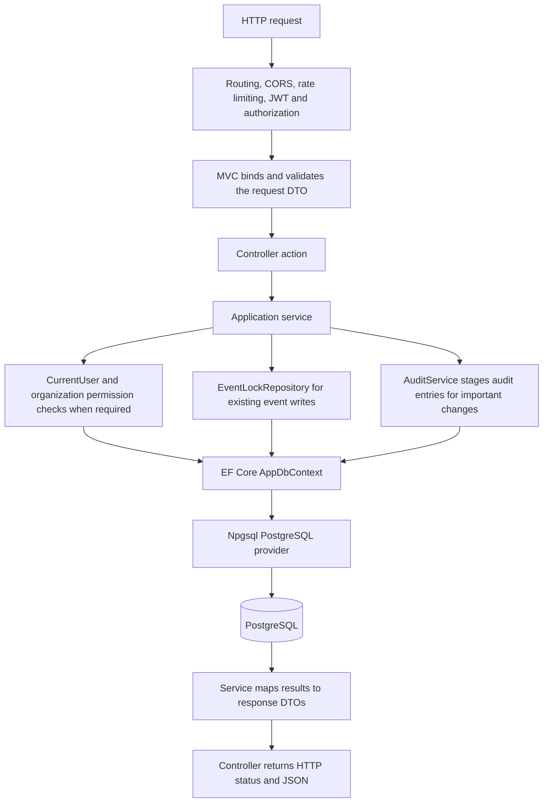

# Backend application flows from HTTP to PostgreSQL

This guide follows the backend currently implemented in the repository: where each request enters, which service handles it, what authorization and business rules run, and which database tables are read or changed. It describes available backend operations; it does not imply that every operation already has a frontend screen.

Paths below are relative to the repository. For configuration and request payloads, see the [README](../README.md). For requirements, design decisions, and verification evidence, see [Backend implementation and traceability](Backend-Implementation.md).

## 1. The shared request path



This diagram shows the participating layers. The exact order of validation, authorization, and locking inside each service is described in the individual flows below. Public reads do not require a user lookup, and read operations do not create audit rows.

The application is wired in [Program.cs](../backend/UbbEvents.Api/Program.cs):

1. Exception handling and status-code pages provide consistent error responses. Swagger is enabled in Development; production also uses HSTS and HTTPS redirection.
2. Routing selects the endpoint. CORS checks configured frontend origins. The authentication rate limiter applies to registration and login: a shared allowance of 20 requests per minute per client IP.
3. JWT middleware validates signature, algorithm, issuer, audience, expiration, and a nonempty UUID `sub` claim. Authorization attributes enforce authentication and, on organization creation, the `GlobalAdmin` policy.
4. MVC binds route/query/body values to [DTOs](../backend/UbbEvents.Api/DTOs/Contracts.cs). Invalid model state produces `400`. Unknown JSON properties and numeric JSON enum values are rejected. Services also call `RequestValidation` for their inputs where applicable.
5. The controller delegates to a service and passes the request `CancellationToken`.
6. The service performs the workflow using a scoped `AppDbContext`. The service and its collaborators share that context for the request.
7. Read queries execute through async EF operations such as `AnyAsync`, `CountAsync`, and `ToListAsync`. `DbSet.Add` and property assignments only stage changes; `SaveChangesAsync` writes them.
8. Services return DTOs, and controllers select responses such as `200`, `201`, or `204`. EF entities and password hashes are not returned.

Most queries live directly in their application service. There is no generic repository layer for every entity. [EventLockRepository](../backend/UbbEvents.Api/Repositories/EventLockRepository.cs) centralizes the SQL lock shared by existing-event write workflows. Organization membership writes use a separate organization-row lock inside `OrganizationService`.

### Identity and tenant permissions

[CurrentUser.RequireAsync](../backend/UbbEvents.Api/Services/CurrentUser.cs) obtains the acting user's ID from the validated JWT `sub` claim, queries `Users`, and caches that user for the request. An invalid subject or missing database user causes `401`.

[OrganizationPermissions](../backend/UbbEvents.Api/Services/OrganizationPermissions.cs) checks the current database user and, for non-global administrators, the requested organization's `OrganizationMembers` row:

| Permission method | Allowed actor | Database reads |
| --- | --- | --- |
| `RequireAdminAsync` | Global `ADMIN` | `Users` |
| `RequireStaffAsync` / `CanManageEventsAsync` | Global `ADMIN`, or that organization's `ORG_ADMIN` / `ORGANIZER` | `Users`; `OrganizationMembers` when needed |
| `RequireMemberManagerAsync` | Global `ADMIN`, or that organization's `ORG_ADMIN` | `Users`; `OrganizationMembers` when needed |

Organization roles are checked against the requested tenant, rather than copied into JWTs. Removing a membership therefore affects later requests made with an already-issued token. A member-management request's `UserId` identifies the target member, never the acting administrator.

## 2. Authentication and current-user flows

Sources: [AuthController](../backend/UbbEvents.Api/Controllers/AuthController.cs), [AuthService](../backend/UbbEvents.Api/Services/AuthService.cs), [JwtTokenService](../backend/UbbEvents.Api/Services/JwtTokenService.cs).

### Create a student account

**Entry:** `POST /api/auth/register` → `AuthController.Register(RegisterRequest)` → `AuthService.RegisterAsync`.

1. Validate email, full name, and password. Password length must be 12–128 characters.
2. Trim/lowercase the email and query `Users` for an existing normalized match. A match produces `409`.
3. Create a `User` with `GlobalRole = STUDENT`, trim the full name, and hash the password with `PasswordHasher<User>`. The request has no role-selection field.
4. Stage the user in `db.Users` and a `UserRegistered` entry through `AuditService.Record`.
5. Call `SaveChangesAsync`. EF persists both rows atomically in its save transaction. PostgreSQL also enforces normalized-email uniqueness if simultaneous requests passed the earlier check.
6. After saving, `JwtTokenService.Issue` creates a signed token containing the user ID, global role, token ID, and configured validity period.

**Database:** reads `Users`; inserts `Users` and `AuditLogs`. The token itself is not stored in the database.

**Response:** `201 AuthResponse` containing `accessToken`, `expiresAt`, and the safe user DTO; location `/api/auth/me`.

### Log in

**Entry:** `POST /api/auth/login` → `AuthController.Login(LoginRequest)` → `AuthService.LoginAsync`.

The service validates input, normalizes the email, queries `Users`, and verifies the stored password hash. Missing users and wrong passwords both produce `401`. If the hasher reports that the hash needs upgrading, the service replaces `PasswordHash`, updates `UpdatedAt`, and saves the user. It then issues a JWT.

**Database:** reads `Users`; conditionally updates `Users` for a hash upgrade. Ordinary login does not write an audit row or token record.

**Response:** `200 AuthResponse`.

### Retrieve the current user

**Entry:** `GET /api/auth/me` → `AuthController.Me` → `AuthService.MeAsync`.

After authentication, `CurrentUser.RequireAsync` loads the user. The service joins `OrganizationMembers` to `Organizations`, filters by that user's ID, and orders memberships by organization name. Each membership includes the organization ID, name, and role.

**Database:** reads `Users`, `OrganizationMembers`, and `Organizations`; no writes.

**Response:** `200 CurrentUserResponse` with the user and their memberships.

## 3. Organization onboarding and membership flows

Sources: [OrganizationsController](../backend/UbbEvents.Api/Controllers/OrganizationsController.cs), [OrganizationService](../backend/UbbEvents.Api/Services/OrganizationService.cs).

### Create an organization and appoint its first administrator

**Entry:** `POST /api/organizations` → `OrganizationsController.Create(CreateOrganizationRequest)` → `OrganizationService.CreateAsync`.

1. The controller's `GlobalAdmin` policy checks the token role. The service additionally calls `RequireAdminAsync` to verify the database user's global role.
2. Validate the request and nonempty initial administrator ID. Query `Users` to ensure that the target account exists.
3. Trim the organization name and check `Organizations` for an existing equal name. The database has a unique name index as the final safeguard.
4. Stage the new organization and an `OrganizationMember` with the target user, new organization ID, and `ORG_ADMIN` role.
5. Stage `OrganizationCreated` and `MemberAssigned` audit entries.
6. Save all four rows atomically with one `SaveChangesAsync` call.

**Database:** reads `Users` and `Organizations`; inserts `Organizations`, `OrganizationMembers`, and two `AuditLogs` rows.

**Response:** `201 OrganizationResponse` with the new organization's URL.

### Browse organizations and members

| Route | Controller → service | Database work and visibility |
| --- | --- | --- |
| `GET /api/organizations` | `List` → `ListAsync` | Load the current user; query all organizations for global ADMIN, otherwise only organizations with a membership for that user. Count, order by name/ID, and page. |
| `GET /api/organizations/{id}` | `Get` → `GetAsync` | Require staff permission for that organization, then read its `Organizations` row. |
| `GET /api/organizations/{id}/members` | `Members` → `MembersAsync` | Require tenant staff permission, verify organization existence, and join `OrganizationMembers` with `Users`; order by full name/user ID and page. |

These routes return `200` DTOs and perform no writes. List responses contain `items`, `page`, `pageSize`, and `totalCount`. Member DTOs expose name, email, user ID, and organization role; they do not expose password hashes.

### Add an organizer or another organization administrator

**Entry:** `POST /api/organizations/{id}/members` → `OrganizationsController.AddMember(AddMemberRequest)` → `OrganizationService.AddMemberAsync`.

1. Validate the target user ID and explicit organization role.
2. Begin an explicit READ COMMITTED transaction and call `LockOrganizationAsync`. It selects the organization's row `FOR UPDATE`; absence produces `404`.
3. Require member-manager permission for that organization. An `ORG_ADMIN` may add `ORGANIZER` members; assigning `ORG_ADMIN` requires global `ADMIN`.
4. Load the target user and check that the `(UserId, OrganizationId)` membership does not already exist.
5. Insert the membership, stage `MemberAssigned`, save, and commit.

**Database:** reads/locks `Organizations`; reads `Users` and `OrganizationMembers`; inserts `OrganizationMembers` and `AuditLogs`. The membership composite primary key prevents duplicates.

**Response:** `201 MemberResponse`. Duplicate membership produces `409`.

### Change a member's role or remove a membership

**Entries:**

- `PUT /api/organizations/{id}/members/{userId}` → `UpdateMember(UpdateMemberRequest)` → `ChangeMemberAsync(id, userId, request, ct)`.
- `DELETE /api/organizations/{id}/members/{userId}` → `RemoveMember` → `ChangeMemberAsync(id, userId, null, ct)`.

Both paths begin a READ COMMITTED transaction, lock the organization, require member-manager permission, and load the target membership. Only global ADMIN can appoint, demote, or remove an `ORG_ADMIN`. If the operation would remove or demote an organization administrator, the service checks that another `ORG_ADMIN` remains. The organization lock serializes these checks with other membership writes.

PUT updates `OrganizationMembers.OrgRole` and stages `MemberRoleChanged`. DELETE physically removes the membership row and stages `MemberRemoved`. Removing a membership does not delete the user or their registrations; its audit history remains. The service saves and commits before returning `204`.

## 4. Event discovery and details

Sources: [EventsController](../backend/UbbEvents.Api/Controllers/EventsController.cs), [EventService](../backend/UbbEvents.Api/Services/EventService.cs).

### Search and list events

**Entry:** `GET /api/events` → `EventsController.List(EventQuery)` → `EventService.ListAsync`.

The service validates query parameters and builds an `AsNoTracking` query over `Events`:

- Normally, exclude `DRAFT` events. Other statuses, including completed/cancelled events, remain available unless the request filters them out.
- With `includeDrafts=true`, require authentication. Global ADMIN can see all drafts; other users see public events plus drafts belonging to organizations where they are members.
- Apply optional organization ID, status, exact type, case-insensitive title/description/venue search, and inclusive start-time range filters.
- Count matching rows, order by `StartTime` then `Id`, and apply `Skip`/`Take` for the requested page.
- Map results to `EventResponse` DTOs.

**Database:** reads `Events`; also `Users` and potentially `OrganizationMembers` when drafts are requested. No writes or explicit transaction.

**Response:** `200 PagedResponse<EventResponse>`. Paging defaults to page 1 and 20 items; page size is limited to 100.

### Get an event

**Entry:** `GET /api/events/{id}` → `EventsController.Get` → `EventService.GetAsync`.

Read the event without tracking. If it is a draft, call `CanManageEventsAsync` for its organization. A missing event or a draft inaccessible to the caller produces `404`. Other statuses can be read publicly.

**Database:** reads `Events`; draft permission checks may read `Users` and `OrganizationMembers`.

**Response:** `200 EventResponse`; no writes.

## 5. Event creation, editing, and lifecycle

### Create a draft

**Entry:** `POST /api/events` → `EventsController.Create(CreateEventRequest)` → `EventService.CreateAsync`.

Validate required fields, positive capacity, nonempty organization ID, and `EndTime > StartTime`. Require staff permission and verify that the organization exists. Create the event with `Status = DRAFT`, `Version = 1`, and `CreatedBy` from the current user. Trim text fields and convert incoming `DateTimeOffset` values to UTC. Stage `EventCreated`, then save the event and audit atomically.

**Database:** reads `Users`, `Organizations`, and membership when required; inserts `Events` and `AuditLogs`.

**Response:** `201 EventResponse` with the event URL. The client cannot choose an initial status or creator ID.

### Edit event details or capacity

**Entry:** `PUT /api/events/{id}` → `EventsController.Update(UpdateEventRequest)` → `EventService.UpdateAsync`.

1. Validate fields and the supplied event version.
2. Begin a READ COMMITTED transaction and acquire the parent event lock through `EventLockRepository.LockAsync`.
3. Require staff permission using the locked event's `OrganizationId`.
4. Compare the submitted version with the current version. Reject stale edits and edits to `COMPLETED`/`CANCELLED` events with `409`.
5. Count CONFIRMED registrations while holding the lock. Reject capacity below that count.
6. Apply the details and increment `Event.Version` explicitly.
7. Call `WaitlistService.PromoteAsync` with the number of free places. While registration is open, available places are filled from the existing queue, including when capacity increases.
8. Stage `EventUpdated`, save all event/registration/audit changes, and commit.

**Database:** locks/updates `Events`; reads `Registrations`, `Users`, and membership as required; may update waitlisted `Registrations`; inserts `AuditLogs`.

**Response:** `200 EventResponse` with the new version. Updating details does not transfer an event to another organization or change its status.

### Publish, open registration, complete, or cancel an event

**Entry:** `PATCH /api/events/{id}/status` → `EventsController.ChangeStatus(ChangeEventStatusRequest)` → `EventService.ChangeStatusAsync` → [EventLifecycle.EnsureTransition](../backend/UbbEvents.Api/Services/EventLifecycle.cs).

The service begins a READ COMMITTED transaction, locks the event, checks tenant permission, and verifies the submitted version. The dedicated lifecycle component permits exactly these transitions:

| Current status | Allowed next status |
| --- | --- |
| `DRAFT` | `PUBLISHED` |
| `PUBLISHED` | `REGISTRATION_OPEN`, `CANCELLED` |
| `REGISTRATION_OPEN` | `COMPLETED`, `CANCELLED` |
| `COMPLETED` | None |
| `CANCELLED` | None |

For an allowed transition, update the status, increment the version, and stage `EventStatusChanged` with the old/new status. Invalid transitions, including repeating the same status, produce `409`.

When the new status is `CANCELLED`, also load all active registrations. For each, stage an `EventCancellation` audit entry containing its previous status/check-in state, change status to `CANCELED`, and clear `CheckedIn`. No waitlist promotion occurs. Completing an event preserves existing registration and attendance records.

**Database:** locks/updates `Events`; cancellation also reads/updates `Registrations`; inserts the corresponding `AuditLogs`. All changes save and commit together.

**Response:** `200 EventResponse` with the updated status/version. There are no separate publish/open/complete/cancel routes; they share this status endpoint.

## 6. Transactional participant registration and re-registration

Sources: [RegistrationsController](../backend/UbbEvents.Api/Controllers/RegistrationsController.cs), [RegistrationService](../backend/UbbEvents.Api/Services/RegistrationService.cs), [EventLockRepository](../backend/UbbEvents.Api/Repositories/EventLockRepository.cs).

**Entry:** `POST /api/events/{id}/registrations` → `RegistrationsController.Register` → `RegistrationService.RegisterAsync`.

The operation takes no request-body DTO. The participant is always the authenticated user; a supplied body user ID cannot register another account.

```mermaid
sequenceDiagram
    participant C as Client
    participant API as RegistrationsController
    participant S as RegistrationService
    participant L as EventLockRepository
    participant DB as PostgreSQL through EF Core
    C->>API: POST event registrations with bearer token
    API->>S: RegisterAsync(eventId, ct)
    S->>DB: Load current user from JWT subject
    S->>DB: BEGIN READ COMMITTED
    S->>L: LockAsync(eventId, ct)
    L->>DB: SET LOCAL lock_timeout and SELECT event FOR UPDATE
    DB-->>S: Locked event
    S->>S: Require REGISTRATION_OPEN
    S->>DB: Read user-event registration and confirmed count
    alt Active registration already exists
        S-->>API: Conflict; transaction disposed without commit
        API-->>C: 409 ProblemDetails
    else New or previously canceled registration
        S->>S: Assign CONFIRMED or WAITLISTED
        S->>DB: Save registration and audit row
        S->>DB: COMMIT and release event lock
        S-->>API: RegistrationResponse
        API-->>C: 200 with actual registration status
    end
```

The service checks event status **after acquiring the lock**. Only `REGISTRATION_OPEN` accepts registrations. An existing CONFIRMED or WAITLISTED registration produces `409`. Otherwise, count confirmed registrations: below `MaxCapacity` assigns CONFIRMED; full capacity assigns WAITLISTED.

For a first registration, insert a new row. For an existing CANCELED registration, reuse the same row and ID. Both paths set `RegisteredAt` to the current UTC time and reset `CheckedIn = false`. Reactivation therefore rejoins the queue according to its new registration time when the event is full.

Stage `RegistrationCreated` or `RegistrationReactivated`, call `SaveChangesAsync`, and commit before returning `200 RegistrationResponse`. The response includes registration ID, event/user IDs, actual status, check-in flag, and registration time. Registration does not increment the event's edit version.

**Database:** reads `Users`; locks `Events`; reads `Registrations`; inserts or updates `Registrations`; inserts `AuditLogs`. The unique `(EventId, UserId)` index remains a duplicate safeguard.

## 7. Participant cancellation and FIFO promotion

**Entry:** `DELETE /api/events/{id}/registrations/me` → `RegistrationsController.Cancel` → `RegistrationService.CancelAsync` → [WaitlistService.PromoteAsync](../backend/UbbEvents.Api/Services/WaitlistService.cs) when applicable.

1. Resolve the participant from claims, begin a READ COMMITTED transaction, and lock the event.
2. Load the registration by both event ID and acting user ID. If absent, return `404`.
3. If already CANCELED, commit without changes and return `204`. No duplicate cancellation audit or promotion is written.
4. Reject cancellation of an active registration for a COMPLETED event, or a checked-in registration, with `409`.
5. Change the registration status to CANCELED and stage `RegistrationCanceled`.
6. If the previous status was CONFIRMED, call `PromoteAsync` for one place. If it was WAITLISTED, skip promotion.
7. Save the cancellation, any promotion, and all audit entries together; commit; return `204`.

`WaitlistService` uses the caller's transaction/context. It does not start its own transaction or save independently. The caller must already hold the event-row lock. The helper only promotes while the event is REGISTRATION_OPEN and the requested number of places is positive. It selects WAITLISTED rows for that event, ordered by `RegisteredAt`, then `Id`, and changes the selected rows to CONFIRMED, staging `WaitlistPromoted` for each.

For example, at capacity 1, Alice is confirmed, Bob is first on the waitlist, and Carol is second. Alice's cancellation saves Alice as CANCELED and Bob as CONFIRMED in the same transaction; Carol remains WAITLISTED. A subsequent Alice re-registration reuses her row and receives a new timestamp, placing her behind Carol while full.

**Database:** reads `Users`; locks `Events`; reads/updates `Registrations`; inserts `AuditLogs`. No registration row is deleted.

## 8. Participant history and organizer registration lists

| Route | Controller → service | Reads and response |
| --- | --- | --- |
| `GET /api/registrations/me` | `Mine` → `RegistrationService.MineAsync` | Resolve the user; join their `Registrations` to `Events`; optionally filter registration status; order by registration time descending then registration ID; return `200 PagedResponse<MyRegistrationResponse>`. |
| `GET /api/events/{id}/registrations` | `Participants` → `RegistrationService.ParticipantsAsync` | Read the event and require its tenant staff permission; join event `Registrations` to `Users`; optionally filter status; order by registration time then registration ID; return `200 PagedResponse<ParticipantResponse>`. |

History includes canceled rows and event title/status/time/venue. Organizer lists include participant name/email and check-in state. `status=CONFIRMED` or `status=WAITLISTED` provides the corresponding participant list through the same endpoint. Both flows are read-only; users cannot select someone else's history by submitting a user ID.

## 9. Attendance and check-in

Sources: [AttendanceController](../backend/UbbEvents.Api/Controllers/AttendanceController.cs), [AttendanceService](../backend/UbbEvents.Api/Services/AttendanceService.cs).

### Check in a participant

**Entry:** `POST /api/events/{id}/check-in` → `AttendanceController.CheckIn(CheckInRequest)` → `AttendanceService.CheckInAsync`.

Validate the nonempty registration ID. Begin a READ COMMITTED transaction, lock the event, and require staff permission for its organization. Check that registration is open. Load the registration using **both** its ID and the route's event ID, so a registration from another event cannot be checked in through this route.

The registration must exist, be CONFIRMED, and not already be checked in. Otherwise return `404` for a missing/mismatched registration or `409` for an ineligible/duplicate check-in. Set `CheckedIn = true`, stage `ParticipantCheckedIn`, save, and commit.

**Database:** locks `Events`; reads `Users` and membership when needed; reads/updates `Registrations`; inserts `AuditLogs`.

**Response:** `200 RegistrationResponse` with `checkedIn=true`. There is no additional restriction based on scheduled start/end time; eligibility currently depends on event/registration state. Concurrent check-ins serialize on the event lock.

### Retrieve attendance totals

**Entry:** `GET /api/events/{id}/attendance` → `AttendanceController.Totals` → `AttendanceService.TotalsAsync`.

Read the event, require tenant staff permission, and execute an aggregate over that event's registrations. Count CONFIRMED, WAITLISTED, CANCELED, and checked-in rows. With no registrations, return zero for each total.

**Database:** reads `Events`, `Registrations`, and authorization data; no writes or event-row lock.

**Response:** `200 AttendanceResponse`.

## 10. What makes the database writes safe

### Event lock and transaction boundary

`EventLockRepository.LockAsync` requires an active transaction and executes parameterized SQL equivalent to:

```sql
SET LOCAL lock_timeout = '5s';
SELECT * FROM "Events" WHERE "Id" = @eventId FOR UPDATE;
```

This is the core SQL, not an exact dump of EF's surrounding query. `FromSqlInterpolated` binds the ID as a parameter. The service holds the lock until commit/rollback. READ COMMITTED allows registration-count queries issued after a wait to see the previous request's committed changes.

Existing-event writes all follow the same parent-before-registration lock order: event edits/capacity changes, lifecycle transitions, registration, participant cancellation/promotion, and check-in. Two requests for the same event serialize at that row. The lock does not globally serialize unrelated event rows. A lock timeout becomes `409`.

`Version` protects clients from overwriting stale event details/status. Services compare the supplied version and increment it, while EF also uses the property as a concurrency token. Version checking alone does not protect the registration count; event locking provides that protection. SQL writers outside these services must follow the same capacity-locking protocol.

Membership changes use their organization's parent-row lock. That lock protects duplicate/last-administrator decisions across simultaneous membership mutations; it is separate from the event-lock repository.

### EF mappings and PostgreSQL safeguards

[AppDbContext](../backend/UbbEvents.Api/Data/AppDbContext.cs) maps the entities and relationships. [InitialCreate](../backend/UbbEvents.Api/Data/Migrations/20261107162303_InitialCreate.cs) and the additive [BackendCompletion migration](../backend/UbbEvents.Api/Data/Migrations/20261109201157_BackendCompletion.cs) establish the database structures:

| Table | Used for | Important database safeguards |
| --- | --- | --- |
| `Users` | Account identity and password hashes | UUID primary key; email uniqueness; normalized-email expression index; valid global role |
| `Organizations` | Tenant identity | UUID primary key; unique name |
| `OrganizationMembers` | Per-organization permissions | Composite `(UserId, OrganizationId)` primary key; user/organization foreign keys; valid organization role |
| `Events` | Event details, lifecycle, capacity/version | Organization/creator foreign keys; positive capacity; end after start; valid status; EF version concurrency predicate |
| `Registrations` | Participation, waitlist, attendance/history | User/event foreign keys; unique `(EventId, UserId)`; valid status; false check-in default; check-in requires CONFIRMED |
| `AuditLogs` | Persistent action history | Actor/organization foreign keys with restricted deletion; tenant/time and entity/time indexes |

Dates are persisted as UTC PostgreSQL timestamps with time zone, and enums are stored as strings. Capacity versus the number of confirmed registrations and allowed lifecycle transitions are enforced by the locked application workflows, rather than a database count constraint or trigger.

### Auditing and rollback

[AuditService.Record](../backend/UbbEvents.Api/Services/AuditService.cs) only adds an `AuditLog` to the shared context. Each row records acting user, optional organization, entity type/ID, action, optional details, and UTC occurrence time. It never saves separately.

For simple creates, one `SaveChangesAsync` persists the domain rows and audits atomically. For explicitly transactional flows, the service saves then commits the transaction. If a guard fails or saving/committing fails before a successful commit, the operation does not commit partial business/audit changes. A promotion is therefore committed together with the cancellation or capacity update that caused it.

No public audit-list endpoint exists. Audit details contain status, role, version, or prior check-in information; passwords, signing keys, and access tokens are not recorded.

## 11. Error path back to the client

[ApiExceptionHandler](../backend/UbbEvents.Api/Infrastructure/ApiException.cs) converts service and selected EF/PostgreSQL exceptions into ProblemDetails. Middleware/status-code pages and MVC handle errors raised before service execution.

| Status | Typical source in these flows |
| --- | --- |
| `400` | Invalid DTO/query, missing required field, invalid enum/date/capacity/version, empty required UUID |
| `401` | Missing/invalid JWT, missing current database user, invalid login, or an authenticated-only draft query made anonymously |
| `403` | Valid user lacks global or requested-organization permission |
| `404` | Missing resource, inaccessible draft, nonexistent own registration, or check-in registration not belonging to the route event |
| `409` | Invalid state transition, registration closed, duplicate active registration/member/email, capacity conflict, stale version, duplicate/ineligible check-in, last-admin conflict, lock timeout/deadlock/serialization conflict, or selected database constraint failures |
| `429` | Authentication request limit reached |
| `500` | Unexpected failure, with generic response details |

Responses include a trace ID. Exception responses do not expose SQL, connection strings, stack traces, or secrets. Check the ProblemDetails detail to distinguish a retryable lock conflict from a duplicate registration or invalid business transition. A stale event edit requires reloading the current version.

## 12. Startup and endpoints without a database request flow

### Optional development administrator bootstrap

This is a startup flow, not a controller endpoint: `Program.cs` → [DevelopmentAdminSeeder.SeedAsync](../backend/UbbEvents.Api/Services/DevelopmentAdminSeeder.cs).

When `DevelopmentAdmin:Enabled` is false, return immediately. When enabled, require Development and validate the configured credentials. Create a DI scope, begin a READ COMMITTED transaction, and acquire a PostgreSQL transaction-level advisory lock to serialize bootstraps. Look up the normalized email in `Users`:

- An existing ADMIN causes a no-change commit; the password is not reset.
- An existing STUDENT causes startup failure; the account is not elevated.
- An absent user is created as ADMIN with a hashed password, together with `DevelopmentAdminCreated` in `AuditLogs`; save and commit.

Startup does not apply migrations. Schema updates use reviewed `dotnet ef` migration commands before starting the application or enabling bootstrap.

### Health endpoint

`GET /api/health` is a minimal endpoint in `Program.cs`, not a controller action. It returns `200 HealthResponse` as `{ "status": "ok" }` without a service or database query. It checks application liveness, not database connectivity/readiness.

### Preserved weather sample

The original [WeatherForecastController](../backend/UbbEvents.Api/Controllers/WeatherForecastController.cs) still exposes `GET /WeatherForecast`. It generates sample forecasts in memory and has no service/database path. It is a scaffold sample, outside the event-management workflows.

## 13. A complete usage walkthrough

1. Register the intended organization administrator, organizer, and participant accounts through `AuthController.Register`. Each is initially a STUDENT in `Users`.
2. Obtain a global ADMIN token using the configured development bootstrap account and `AuthController.Login`.
3. Call `OrganizationsController.Create` to create a tenant and its initial ORG_ADMIN membership atomically.
4. Log in as that organization administrator and call `AddMember` to assign the organizer's membership within the same organization.
5. As staff, call `EventsController.Create`. Save the returned event ID and version; the event is DRAFT.
6. Call `ChangeStatus` to PUBLISHED, then REGISTRATION_OPEN, using the latest returned version each time. Public discovery now exposes the event; registration becomes possible only after opening.
7. Participants discover the event and call `RegistrationsController.Register`. The first available places become CONFIRMED; later participants become WAITLISTED.
8. A confirmed participant cancels through `Cancel`. The same transaction preserves the canceled record and promotes the oldest eligible waiter. Participants can inspect their current status/history through `Mine`.
9. Staff list CONFIRMED registrations through `Participants`, use a returned registration ID with `AttendanceController.CheckIn`, and inspect `Totals`.
10. Staff complete the event through `ChangeStatus` using its current version. Registration/check-in stop, while existing participation, attendance, and audit records remain in PostgreSQL.

At every tenant-scoped step, permissions come from the requested organization's membership. Using an event or organization ID from another tenant does not transfer those permissions.
