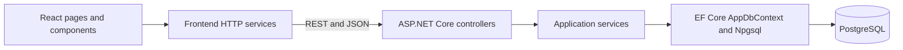

# Project structure

This guide maps the current UBB Event Management repository so a new contributor can locate application code, configuration, tests, infrastructure, and documentation. It describes the files present in the workspace, including the frontend implementation currently being developed.

The project consists of a React/TypeScript browser application, an ASP.NET Core 8 API, and PostgreSQL 16. The browser communicates with the API over HTTP; database access belongs to the backend. `UbbEvents.sln` contains the API and its .NET test project. The frontend is a separate npm project and is not built by `dotnet build`.



For detailed execution paths and transaction boundaries, see [Backend flows](Backend-Flows.md). For local setup commands and environment values, see the [root README](../README.md) and [frontend README](../frontend/README.md).

## Repository map

The tree below shows the principal source and configuration files. Generated build output, installed dependencies, private environment files, and individual reference DOCX files are omitted. Tables later in this guide explain their locations.

```text
ubb-event-management/
|-- UbbEvents.sln
|-- README.md
|-- AGENTS.md
|-- .gitignore
|-- .dockerignore
|-- .env.example
|-- docker-compose.yml
|-- .config/
|   `-- dotnet-tools.json
|-- .github/
|   `-- workflows/
|       `-- backend.yml
|-- backend/
|   |-- Dockerfile
|   |-- UbbEvents.Api/
|   |   |-- UbbEvents.Api.csproj
|   |   |-- Program.cs
|   |   |-- appsettings.json
|   |   |-- appsettings.Development.json
|   |   |-- Properties/
|   |   |   `-- launchSettings.json
|   |   |-- Controllers/
|   |   |-- DTOs/
|   |   |   `-- Contracts.cs
|   |   |-- Models/
|   |   |   |-- Entities.cs
|   |   |   `-- AuditLog.cs
|   |   |-- Services/
|   |   |-- Repositories/
|   |   |   `-- EventLockRepository.cs
|   |   |-- Infrastructure/
|   |   |   |-- ApiException.cs
|   |   |   `-- AuthorizationOperationFilter.cs
|   |   |-- Data/
|   |   |   |-- AppDbContext.cs
|   |   |   `-- Migrations/
|   |   |-- UbbEvents.Api.http
|   |   `-- WeatherForecast.cs
|   `-- UbbEvents.Api.Tests/
|       |-- UbbEvents.Api.Tests.csproj
|       |-- PostgresFixture.cs
|       |-- GlobalUsings.cs
|       |-- EventLifecycleTests.cs
|       |-- EventApiTests.cs
|       |-- AuthAndOrganizationTests.cs
|       |-- SecurityTests.cs
|       |-- RegistrationTests.cs
|       |-- ConcurrencyTests.cs
|       |-- AttendanceTests.cs
|       `-- PersistenceTests.cs
|-- frontend/
|   |-- README.md
|   |-- package.json
|   |-- package-lock.json
|   |-- .env.example
|   |-- .gitignore
|   |-- index.html
|   |-- vite.config.ts
|   |-- eslint.config.js
|   |-- tsconfig.json
|   |-- tsconfig.app.json
|   |-- tsconfig.node.json
|   |-- public/
|   |-- scripts/
|   |   `-- api-smoke.mjs
|   |-- docs/
|   |   |-- API-INTEGRATION.md
|   |   |-- USER-FLOWS.md
|   |   |-- VALIDATION.md
|   |   `-- GENAI-USAGE.md
|   `-- src/
|       |-- main.tsx
|       |-- App.tsx
|       |-- index.css
|       |-- app/
|       |   `-- queryClient.ts
|       |-- assets/
|       |-- components/
|       |   |-- common/
|       |   |-- layout/
|       |   |-- events/
|       |   |-- organizations/
|       |   `-- registrations/
|       |-- contexts/
|       |   |-- AuthProvider.tsx
|       |   `-- auth.ts
|       |-- hooks/
|       |   |-- queries.ts
|       |   |-- useAction.ts
|       |   |-- useOrganizationScope.ts
|       |   `-- useOrganizationOptions.ts
|       |-- pages/
|       |   |-- public/
|       |   |-- auth/
|       |   |-- student/
|       |   |-- organizer/
|       |   `-- admin/
|       |-- services/
|       |   |-- api.ts
|       |   |-- authService.ts
|       |   |-- eventService.ts
|       |   |-- organizationService.ts
|       |   `-- registrationService.ts
|       |-- types/
|       |   `-- api.ts
|       |-- utils/
|       |   |-- dates.ts
|       |   `-- domain.ts
|       `-- test/
`-- docs/
    |-- Project-Structure.md
    |-- Backend-Flows.md
    `-- Backend-Implementation.md
```

## Backend organization

All API source is under `backend/UbbEvents.Api/`. The [project file](../backend/UbbEvents.Api/UbbEvents.Api.csproj) targets .NET 8 and declares EF Core, Npgsql, JWT bearer authentication, and Swagger dependencies.

| Location | Responsibility and important files |
| --- | --- |
| [Program.cs](../backend/UbbEvents.Api/Program.cs) | Application entry point and composition root. Registers the context/services, configures JWT, authorization, CORS, rate limiting, ProblemDetails, Swagger, middleware, controller routes, and health endpoint. Calls the optional development admin seeder. |
| [Controllers/](../backend/UbbEvents.Api/Controllers) | HTTP entry points: `AuthController`, `OrganizationsController`, `EventsController`, `RegistrationsController`, and `AttendanceController`. Controllers bind DTOs, delegate workflows, and choose response status codes. |
| [DTOs/Contracts.cs](../backend/UbbEvents.Api/DTOs/Contracts.cs) | Request/response contracts, input validation attributes, paging/filter types, and response records. These are the public API shapes consumed by the frontend. |
| [Models/Entities.cs](../backend/UbbEvents.Api/Models/Entities.cs) | Persistence entities and enums for users, organizations, memberships, events, and registrations. |
| [Models/AuditLog.cs](../backend/UbbEvents.Api/Models/AuditLog.cs) | Persistent action history with actor, organization, affected entity, action, details, and timestamp. |
| [Services/](../backend/UbbEvents.Api/Services) | Business rules, permission checks, state transitions, transactions, registration/waitlist workflows, authentication, and attendance. See the service map below. |
| [Repositories/EventLockRepository.cs](../backend/UbbEvents.Api/Repositories/EventLockRepository.cs) | Shared PostgreSQL event-row locking for existing-event writes. Most ordinary EF queries remain in their service; there is no generic repository framework. |
| [Data/AppDbContext.cs](../backend/UbbEvents.Api/Data/AppDbContext.cs) | EF entity sets, relationships, enum conversions, keys, indexes, check constraints, and event-version concurrency mapping. |
| [Data/Migrations/](../backend/UbbEvents.Api/Data/Migrations) | Versioned schema changes, generated migration designer files, and `AppDbContextModelSnapshot.cs`. Preserve existing migrations; schema changes require additive migrations. |
| [Infrastructure/ApiException.cs](../backend/UbbEvents.Api/Infrastructure/ApiException.cs) | Service validation helpers, HTTP-oriented exceptions, and conversion of application/database exceptions into safe ProblemDetails responses. |
| [Infrastructure/AuthorizationOperationFilter.cs](../backend/UbbEvents.Api/Infrastructure/AuthorizationOperationFilter.cs) | Swagger security metadata for public and authenticated operations. |
| [Properties/launchSettings.json](../backend/UbbEvents.Api/Properties/launchSettings.json) | Local launch profiles, Development environment, and HTTP/HTTPS listening URLs. |
| [UbbEvents.Api.http](../backend/UbbEvents.Api/UbbEvents.Api.http) | Existing HTTP request scratch file. Use current Swagger and the README as the event API contract reference. |

`WeatherForecast.cs` and `Controllers/WeatherForecastController.cs` are retained scaffold samples. They generate in-memory weather data and do not participate in event persistence or domain workflows.

### Service map

All files in this table are in `backend/UbbEvents.Api/Services/`.

| File | Responsibility |
| --- | --- |
| `AuthService.cs` | Student registration, login/password verification, optional hash upgrade, and current-user response. |
| `JwtTokenService.cs` | JWT configuration/options validation and access-token generation. |
| `CurrentUser.cs` | Resolve the acting user from validated claims and the `Users` table. |
| `OrganizationPermissions.cs` | Global-admin and organization-specific staff/member-management authorization. |
| `OrganizationService.cs` | Organization onboarding, visibility, membership management, organization-row locking, and last-administrator protection. |
| `EventService.cs` | Event discovery/details, draft creation, versioned editing, capacity checks, and lifecycle operations. |
| `EventLifecycle.cs` | Explicit allowed event-state transitions. |
| `RegistrationService.cs` | Transactional registration, canceled-row reactivation, own-history queries, participant lists, and cancellation. |
| `WaitlistService.cs` | FIFO promotion inside the caller's event-locked transaction. |
| `AttendanceService.cs` | Authorized confirmed-participant check-in and aggregate attendance totals. |
| `AuditService.cs` | Stage audit entries in the same context as their business change. |
| `DevelopmentAdminSeeder.cs` | Optional, idempotent, development-only administrator bootstrap using configured credentials. |
| `DtoMapping.cs` | Entity-to-response DTO mapping helpers. |

The context is the shared unit of work. Services own transaction boundaries; audit entries and business changes save together. New domain rules belong in services or focused domain components, rather than in controllers or frontend-only validation.

## Frontend organization

The frontend is an independent React/TypeScript/Vite application in `frontend/`. Its [package.json](../frontend/package.json) defines development, build, preview, lint, and test scripts; `package-lock.json` records resolved dependencies.

### Entry points and shared modules

| Location | Responsibility |
| --- | --- |
| [index.html](../frontend/index.html) | Vite HTML entry with the React root element. |
| [src/main.tsx](../frontend/src/main.tsx) | Mounts React and configures Strict Mode, error boundary, TanStack Query, BrowserRouter, and authentication provider. |
| [src/App.tsx](../frontend/src/App.tsx) | Route definitions, lazy-loaded pages, Suspense loading state, shared layout, protected-route groups, and not-found screen. |
| [src/index.css](../frontend/src/index.css) | Shared visual styling, layout, responsive behavior, and accessibility-related styles. |
| [src/app/queryClient.ts](../frontend/src/app/queryClient.ts) | Creates the TanStack Query client and default caching/retry settings. |
| [src/contexts/AuthProvider.tsx](../frontend/src/contexts/AuthProvider.tsx) | Session lifecycle, current-user loading, login/logout, expiry handling, and clearing query data when sessions change. |
| [src/contexts/auth.ts](../frontend/src/contexts/auth.ts) | Auth context types and the shared `useAuth` hook. |
| [src/hooks/](../frontend/src/hooks) | Shared query/mutation hooks, organization selection in URL parameters, and organization options. |
| [src/services/api.ts](../frontend/src/services/api.ts) | Central fetch wrapper, configured API base URL, in-memory access token, bearer headers, abort signals, and API error translation. |
| [src/services/](../frontend/src/services) | Typed endpoint wrappers grouped by authentication, events, organizations, and registrations/attendance. Pages call these wrappers rather than duplicating HTTP details. |
| [src/types/api.ts](../frontend/src/types/api.ts) | TypeScript representations of backend DTOs, enums, paging, and filters. Keep these aligned with backend contracts. |
| [src/utils/domain.ts](../frontend/src/utils/domain.ts) | Display labels, role/action helpers, and frontend representations of domain rules. Backend authorization and validation remain authoritative. |
| [src/utils/dates.ts](../frontend/src/utils/dates.ts) | UTC/local date conversion and formatting helpers. |
| [src/assets/](../frontend/src/assets) | Assets imported through the source build. |
| [public/](../frontend/public) | Static files served by path, including the favicon and icon sprite. |
| [vite.config.ts](../frontend/vite.config.ts) | Vite React plugin and Vitest configuration, including test environment/setup. |
| [eslint.config.js](../frontend/eslint.config.js) and `tsconfig*.json` | Linting and TypeScript project configuration. |

There is currently no `src/App.css` or `src/pages/HomePage.tsx` in the working implementation: shared styling is in `src/index.css`, and the home page is in `src/pages/public/HomePage.tsx`.

### Components

| Folder under `frontend/src/components/` | Files and purpose |
| --- | --- |
| `common/` | `UI.tsx` contains shared UI primitives and feedback states; `AppErrorBoundary.tsx` handles render failures. |
| `layout/` | `Layout.tsx` provides navigation and the route outlet; `ProtectedRoute.tsx` supplies frontend authentication/staff guards. |
| `events/` | `EventCard.tsx` displays event summaries; `EventForm.tsx` supplies shared event-editing inputs. |
| `organizations/` | `OrganizationPicker.tsx` selects a workspace; `MembersPanel.tsx` displays/manages memberships within UI permissions. |
| `registrations/` | `RegistrationPanel.tsx` shows the participant's event registration state and applicable register/cancel actions. |

### Pages and routes

Pages are grouped by workflow. The `admin/` folder name does not mean every screen in it is global-ADMIN-only: organization staff can access applicable organization screens, while individual actions have additional permission checks.

| Folder under `frontend/src/pages/` | Page files | Routes |
| --- | --- | --- |
| `public/` | `HomePage.tsx`, `EventsPage.tsx`, `EventDetailsPage.tsx` | `/`, `/events`, `/events/:id` |
| `auth/` | `AuthPage.tsx` | `/login`, `/register` |
| `student/` | `RegistrationsPage.tsx`, `ProfilePage.tsx` | `/registrations`, `/profile` |
| `organizer/` | `DashboardPage.tsx`, `ManageEventsPage.tsx` | `/dashboard`, `/manage/events` |
| `organizer/` | `EventEditorPage.tsx` | `/manage/events/new`, `/manage/events/:id/edit` |
| `organizer/` | `ManageEventPage.tsx` | `/manage/events/:id` |
| `organizer/` | `ParticipantsPage.tsx` | `/manage/events/:id/registrations`, `/manage/events/:id/attendance` |
| `admin/` | `OrganizationsPage.tsx`, `OrganizationDetailsPage.tsx` | `/organizations`, `/organizations/:id` |

The same editor serves creation and editing, the same auth page serves login and registration, and the participant page also supports the attendance view. Route guards improve navigation; API services still enforce tenant permissions on every protected backend operation.

## Configuration and infrastructure locations

This section identifies ownership of configuration files. Follow the READMEs for complete setup commands and required secret values.

| File or location | Consumer and purpose |
| --- | --- |
| [Root .env.example](../.env.example) → private root `.env` | Docker Compose substitutions for PostgreSQL and optional pgAdmin credentials. The backend does not automatically read this file as ASP.NET configuration. |
| [docker-compose.yml](../docker-compose.yml) | PostgreSQL 16 service, persistent data volume, health check, and optional pgAdmin `tools` profile. It does not currently define an API or frontend service. |
| [backend/Dockerfile](../backend/Dockerfile) | Separate multi-stage API image build using repository-root build context; publishes the API and runs it as a non-root user on container port 8080. |
| [.dockerignore](../.dockerignore) | Excludes secrets, dependencies, generated output, and unrelated files from the Docker build context. |
| [appsettings.json](../backend/UbbEvents.Api/appsettings.json) | Shared non-secret backend defaults: logging, JWT issuer/audience/lifetime, CORS origins, and bootstrap enabled flag. |
| [appsettings.Development.json](../backend/UbbEvents.Api/appsettings.Development.json) | Environment-specific Development configuration overlay. |
| .NET User Secrets, stored outside the repository | Local backend connection string, JWT signing key, and optional development-admin credentials. The API project declares its User Secrets ID. Environment variables can provide equivalent configuration using `__` between key segments. |
| [launchSettings.json](../backend/UbbEvents.Api/Properties/launchSettings.json) | Local API launch URLs and environment selection. |
| [frontend/.env.example](../frontend/.env.example) → private `frontend/.env.local` | Frontend `VITE_API_URL`. Vite embeds frontend configuration during builds; `VITE_` values are browser-visible and must not contain secrets. |
| [.config/dotnet-tools.json](../.config/dotnet-tools.json) | Repository-local EF CLI version used by `dotnet tool restore` / `dotnet ef`. |
| [.github/workflows/backend.yml](../.github/workflows/backend.yml) | Backend CI restore/build, EF snapshot check, Testcontainers tests, and uploaded test reports. |
| [.gitignore](../.gitignore) and [frontend/.gitignore](../frontend/.gitignore) | Ignore private environment files, dependencies, generated output, and local tooling artifacts. |

The current local API HTTP profile and frontend API fallback use `http://localhost:5088`. The normal Vite dev server uses port 5173; preview defaults to 4173 because no preview port override is configured. The checked-in backend CORS origins currently include both `http://localhost:5173` and `http://localhost:4173`; effective environment/user-secret configuration can override them.

For database addressing, the host API reaches PostgreSQL at `127.0.0.1:5433`; an API container attached to the Compose network uses `postgres:5432`. These addresses select the same database service from different network locations. PostgreSQL data lives in a Docker volume, not a source folder under `backend/`. pgAdmin has its own optional service and volume.

## Tests and generated artifacts

| Location | Purpose |
| --- | --- |
| [backend/UbbEvents.Api.Tests/](../backend/UbbEvents.Api.Tests) | xUnit test project referenced by `UbbEvents.sln`; isolated lifecycle tests plus HTTP/PostgreSQL integration tests grouped by workflow. |
| [PostgresFixture.cs](../backend/UbbEvents.Api.Tests/PostgresFixture.cs) | Starts disposable PostgreSQL, applies migrations there, and provides WebApplicationFactory-based API test setup. It does not use the normal development database. |
| [frontend/src/test/](../frontend/src/test) | Vitest/React Testing Library suites: `api.test.ts`, `auth.test.tsx`, `domain.test.ts`, and `workflows.test.tsx`, with `setup.ts`, `fixtures.ts`, and `render.tsx` helpers. |
| [frontend/scripts/api-smoke.mjs](../frontend/scripts/api-smoke.mjs) | Separate read-only smoke checks against a running API, invoked by `npm run test:api`. |
| `backend/**/bin/` and `backend/**/obj/` | Generated .NET build and intermediate output; ignored by Git. |
| `frontend/node_modules/` | Installed npm dependencies; recreate with `npm ci`, rather than editing installed package sources. |
| `frontend/dist/` | Generated frontend production build; served by preview or a static host. |
| `TestResults/` | Generated backend test reports when the results-directory option is used; CI uploads TRX/HTML reports. |
| Coverage output and local IDE folders | Generated tooling artifacts, excluded through ignore rules. |

Run .NET solution commands from the repository root and npm commands from `frontend/`. The current GitHub workflow targets backend checks; frontend lint/test/build commands are documented in the frontend README. Test-result documents capture past verification and should not be interpreted as proof that a later working tree has been retested.

## Documentation map

| Document | What to use it for |
| --- | --- |
| [Root README](../README.md) | Backend/infrastructure setup, configuration, migrations, API catalog, tests, and container deployment. |
| [Frontend README](../frontend/README.md) | Frontend setup, pages/permissions, session behavior, scripts, and deployment. |
| [Project structure](Project-Structure.md) | This repository and responsibility map. |
| [Backend flows](Backend-Flows.md) | Controller-to-service-to-database execution paths, locking, auditing, and errors. |
| [Backend implementation](Backend-Implementation.md) | Architecture decisions, requirement-to-test traceability, GenAI record, and historical validation evidence. |
| [Frontend user flows](../frontend/docs/USER-FLOWS.md) | Role-specific journeys for guests, participants, organization staff, and administrators. |
| [Frontend API integration](../frontend/docs/API-INTEGRATION.md) | Endpoint/DTO integration, permission assumptions, and frontend/backend gaps. |
| [Frontend validation](../frontend/docs/VALIDATION.md) | Recorded frontend verification evidence and limitations. |
| [Frontend GenAI usage](../frontend/docs/GENAI-USAGE.md) | Frontend generation/review record and human-oversight notes. |
| [AGENTS.md](../AGENTS.md) | Repository-wide instructions for coding agents and contribution safeguards. |

The five reference specifications are also retained in `docs/`: `Project Description.docx`, `Enhanced_MVP_Architecture_DB.docx`, `Technical Documentation Midetrm.docx`, `Repo_Infrastructure_Init.docx`, and `MidTerm Delivery.docx`. They describe requirements and deliverables; inspect current code when establishing what is actually implemented.

## Where to make a change

| Change | Primary locations | Related checks/documentation |
| --- | --- | --- |
| Add or change an API contract | Backend `DTOs/Contracts.cs` and the appropriate controller/service; frontend `types/api.ts` and endpoint service | API integration tests, relevant frontend tests, Swagger/README contract documentation |
| Change an event or registration business rule | Backend `Services/`, especially `EventLifecycle`, `EventService`, `RegistrationService`, or `WaitlistService` | Unit/integration tests; preserve event locking for capacity-related changes; update backend flow/decision docs |
| Add a database field or constraint | Backend entity and `Data/AppDbContext.cs`, then a new generated/reviewed migration | Snapshot consistency and PostgreSQL integration tests; preserve applied migration history |
| Add a frontend route or workflow | `src/pages/`, route registration in `src/App.tsx`, appropriate shared hooks/services | Guard/permission states, loading/errors, workflow tests, and user-flow docs |
| Add a reusable UI element | A focused folder under `src/components/` and existing `src/index.css` conventions | Keyboard, responsive, and component/workflow verification |
| Change authentication or tenant authorization | Backend `Program.cs`, `CurrentUser`, `OrganizationPermissions`, and relevant services; frontend auth/context or guards when UI integration changes | Security and cross-tenant tests; backend checks remain authoritative |
| Change local URLs or origins | API launch/configuration files, frontend API environment value, and CORS configuration | Keep README setup instructions and configuration examples aligned |
| Change CI or container packaging | `.github/workflows/backend.yml`, `backend/Dockerfile`, `.dockerignore`, or Compose when its service configuration is affected | Build/run only against the intended environment and preserve existing database volumes |

Keep secrets and generated artifacts out of commits. Extend the existing modules rather than scaffolding a replacement API/frontend, and update this map when files or responsibilities move.
