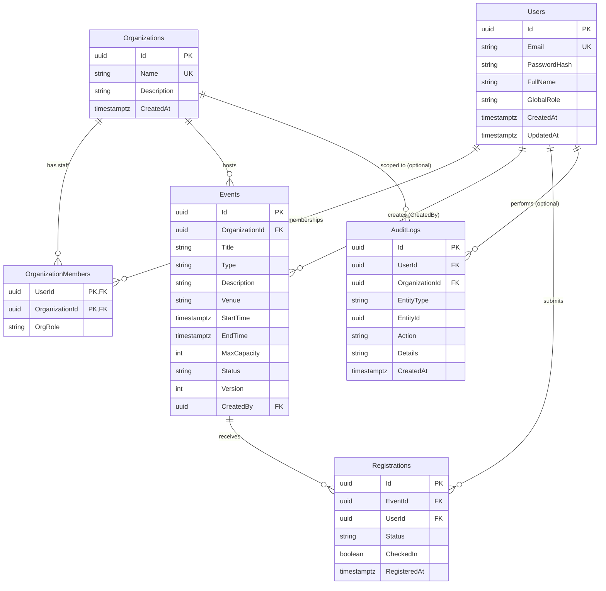

# Database Configuration & Initial Data Model

This document specifies the PostgreSQL 16 persistence configuration, Entity Framework Core 8 (`AppDbContext`) mapping conventions, initial relational schema (`20261107162303_InitialCreate`), additive production hardening (`20261109201157_BackendCompletion`), and transactional concurrency guarantees.

---

## 1. Database & ORM Configuration

- **Database Engine:** PostgreSQL 16 (provisioned via `docker-compose.yml` on host port `5433` -> container port `5432`).
- **ORM & Provider:** Entity Framework Core 8 (`AppDbContext` in `backend/UbbEvents.Api/Data/AppDbContext.cs`) with the `Npgsql.EntityFrameworkCore.PostgreSQL` provider.
- **Migration Strategy:**
  - Code-first migrations are stored under `backend/UbbEvents.Api/Data/Migrations/` and applied explicitly via `dotnet ef database update`.
  - Application startup **does not** execute automatic schema migrations, ensuring safe, reviewable schema transitions.
- **Global Persistence Conventions:**
  - **Primary Keys:** Universally Unique Identifiers (`UUID` / .NET `Guid`) generated for primary entities (`Users`, `Organizations`, `Events`, `Registrations`, `AuditLogs`), or composite foreign keys for join tables (`OrganizationMembers`).
  - **Timestamps:** Persisted exclusively as UTC PostgreSQL `timestamp with time zone` (`timestamptz`). Any incoming `DateTimeOffset` values from API DTOs are normalized to UTC before persistence.
  - **Enumerations:** Persisted as uppercase strings (`varchar` / `text`) rather than integer ordinals, preventing silent enum-reordering bugs and improving SQL readability.

---

## 2. Entity-Relationship Overview



---

## 3. Initial Data Model (`20261107162303_InitialCreate`)

The initial migration establishes the five core domain tables defined in the MVP architecture blueprint:

### 3.1 `Users`
Stores platform accounts, PBKDF2 password hashes (generated by ASP.NET Core `PasswordHasher<User>`), and global authorization roles.

| Column | Type | Constraints & Defaults | Description |
| :--- | :--- | :--- | :--- |
| `Id` | `uuid` | **Primary Key** | Unique user identifier |
| `Email` | `text` / `varchar` | **Not Null, Unique** | Normalized (trimmed, lowercase) email address |
| `PasswordHash` | `text` | **Not Null** | Salted PBKDF2 password hash (never exposed in DTOs) |
| `FullName` | `text` / `varchar` | **Not Null** | User's display name |
| `GlobalRole` | `text` / `varchar` | **Not Null**, Check (`ADMIN`, `STUDENT`) | Global platform role; public signup always sets `STUDENT` |
| `CreatedAt` | `timestamptz` | **Not Null** | UTC account creation timestamp |
| `UpdatedAt` | `timestamptz` | **Not Null** | UTC last-modified timestamp |

### 3.2 `Organizations`
Represents UBB student organizations acting as isolated tenants in the multi-tenant architecture.

| Column | Type | Constraints & Defaults | Description |
| :--- | :--- | :--- | :--- |
| `Id` | `uuid` | **Primary Key** | Unique tenant identifier |
| `Name` | `text` / `varchar` | **Not Null, Unique** | Unique organization name |
| `Description` | `text` | Nullable / Required per DTO | Organization overview |
| `CreatedAt` | `timestamptz` | **Not Null** | UTC organization creation timestamp |

### 3.3 `OrganizationMembers`
Join table modeling many-to-many staff assignments between `Users` and `Organizations`. A user can belong to multiple organizations with different roles.

| Column | Type | Constraints & Defaults | Description |
| :--- | :--- | :--- | :--- |
| `UserId` | `uuid` | **Composite PK (1/2)**, FK -> `Users(Id)` | Staff member user ID |
| `OrganizationId` | `uuid` | **Composite PK (2/2)**, FK -> `Organizations(Id)` | Tenant organization ID |
| `OrgRole` | `text` / `varchar` | **Not Null**, Check (`ORG_ADMIN`, `ORGANIZER`) | Organization-scoped staff role |

### 3.4 `Events`
Stores event metadata, schedule boundaries, capacity limits, lifecycle status, and optimistic edit version.

| Column | Type | Constraints & Defaults | Description |
| :--- | :--- | :--- | :--- |
| `Id` | `uuid` | **Primary Key** | Unique event identifier |
| `OrganizationId` | `uuid` | **Not Null**, FK -> `Organizations(Id)` | Owning student organization |
| `Title` | `text` / `varchar` | **Not Null** | Event title |
| `Type` | `text` / `varchar` | **Not Null** | Event category/type |
| `Description` | `text` | **Not Null** | Event details |
| `Venue` | `text` / `varchar` | **Not Null** | Physical or virtual venue |
| `StartTime` | `timestamptz` | **Not Null** | UTC event start time |
| `EndTime` | `timestamptz` | **Not Null**, Check (`EndTime > StartTime`) | UTC event end time |
| `MaxCapacity` | `integer` | **Not Null**, Check (`MaxCapacity > 0`) | Maximum confirmed participant slots |
| `Status` | `text` / `varchar` | **Not Null**, Check (`DRAFT`, `PUBLISHED`, `REGISTRATION_OPEN`, `COMPLETED`, `CANCELLED`) | Current lifecycle state (starts as `DRAFT`) |
| `Version` | `integer` | **Not Null**, Default `1` | Optimistic edit concurrency token incremented on detail/status updates |
| `CreatedBy` | `uuid` | **Not Null**, FK -> `Users(Id)` | Staff user who created the event |

### 3.5 `Registrations`
Tracks participant enrollments, waitlist queue order, cancellation history, and venue check-in status.

| Column | Type | Constraints & Defaults | Description |
| :--- | :--- | :--- | :--- |
| `Id` | `uuid` | **Primary Key** | Unique registration identifier |
| `EventId` | `uuid` | **Not Null**, FK -> `Events(Id)`, Unique (`EventId`, `UserId`) | Target event |
| `UserId` | `uuid` | **Not Null**, FK -> `Users(Id)`, Unique (`EventId`, `UserId`) | Participating user |
| `Status` | `text` / `varchar` | **Not Null**, Check (`CONFIRMED`, `WAITLISTED`, `CANCELED`) | Current enrollment state |
| `CheckedIn` | `boolean` | **Not Null**, Default `false` | Venue attendance flag |
| `RegisteredAt` | `timestamptz` | **Not Null** | UTC registration (or reactivation) timestamp governing FIFO waitlist order |

---

## 4. Additive Schema & Integrity Enhancements (`20261109201157_BackendCompletion`)

Without altering or resetting `InitialCreate`, the additive `BackendCompletion` migration introduces persistent auditing and PostgreSQL-level data integrity invariants:

### 4.1 `AuditLogs` Table
Provides an immutable, transactionally consistent audit trail for security-sensitive and business-critical mutations.

| Column | Type | Constraints & Defaults | Description |
| :--- | :--- | :--- | :--- |
| `Id` | `uuid` | **Primary Key** | Unique audit entry identifier |
| `UserId` | `uuid` | Nullable, FK -> `Users(Id)` (`ON DELETE RESTRICT`) | Acting user (nullable for system/bootstrap contexts) |
| `OrganizationId` | `uuid` | Nullable, FK -> `Organizations(Id)` (`ON DELETE RESTRICT`) | Associated tenant when applicable |
| `EntityType` | `text` / `varchar` | **Not Null** | Target domain entity name (e.g., `Event`, `Registration`, `OrganizationMember`) |
| `EntityId` | `uuid` | **Not Null** | Polymorphic target entity ID (preserved even if a membership row is later deleted) |
| `Action` | `text` / `varchar` | **Not Null** | Event code (`UserRegistered`, `OrganizationCreated`, `MemberAssigned`, `MemberRoleChanged`, `MemberRemoved`, `EventCreated`, `EventUpdated`, `EventStatusChanged`, `EventCancellation`, `RegistrationCreated`, `RegistrationReactivated`, `RegistrationCanceled`, `WaitlistPromoted`, `ParticipantCheckedIn`, `DevelopmentAdminCreated`) |
| `Details` | `text` | Nullable | Structured state/version transition metadata (never stores secrets or tokens) |
| `CreatedAt` | `timestamptz` | **Not Null** | UTC timestamp when the action occurred |

### 4.2 Additional Database Constraints & Indexes

1. **Case-Insensitive Normalized Email Uniqueness:**
   - Expression unique index on `Users`: `UNIQUE INDEX ... ON "Users" (LOWER(TRIM("Email")))` preventing duplicate accounts with differing letter casing.
2. **Database Enum Domain Constraints:**
   - `CHECK` constraints enforcing valid string values on `Users.GlobalRole`, `OrganizationMembers.OrgRole`, `Events.Status`, and `Registrations.Status`.
3. **Check-In State Invariant:**
   - `CHECK` constraint on `Registrations` enforcing `("CheckedIn" = FALSE OR "Status" = 'CONFIRMED')`, guaranteeing at the database level that waitlisted or canceled records cannot be marked checked in.
4. **Query & FIFO Performance Indexes:**
   - Event discovery index on `Events ("Status", "StartTime")`.
   - FIFO waitlist index on `Registrations ("EventId", "Status", "RegisteredAt", "Id")` to support deterministic promotion ordering (`ORDER BY "RegisteredAt" ASC, "Id" ASC`).
   - Audit query indexes on `AuditLogs ("OrganizationId", "CreatedAt")` and `AuditLogs ("EntityType", "EntityId", "CreatedAt")`.
5. **Legacy Version Normalization:**
   - Data migration step advancing any legacy `Events` rows with `Version = 0` to `Version = 1`.

---

## 5. Concurrency Control & Transaction Boundaries

To guarantee data consistency under high concurrency without relying solely on application-memory checks:

1. **Event-Level Row Locking (`EventLockRepository`):**
   - Every write operation targeting an existing event (registration, re-registration, cancellation, waitlist promotion, check-in, event editing, and status transition) opens an explicit `READ COMMITTED` database transaction and executes:
     ```sql
     SET LOCAL lock_timeout = '5s';
     SELECT * FROM "Events" WHERE "Id" = @eventId FOR UPDATE;
     ```
   - Concurrent requests for the *same* event serialize cleanly on the parent `Events` row, guaranteeing that `COUNT(*) WHERE Status = 'CONFIRMED'` never exceeds `MaxCapacity` and that FIFO waitlist promotions never double-promote. Lock timeouts return `409 Conflict`.
2. **Organization-Level Row Locking (`OrganizationService`):**
   - Membership additions, role updates, and removals lock the target `Organizations` row `FOR UPDATE` inside a `READ COMMITTED` transaction so concurrent requests cannot remove or demote the final `ORG_ADMIN`.
3. **Atomic Domain + Audit Persistence:**
   - `AuditService.Record` stages `AuditLog` entities in the same scoped `AppDbContext` as domain mutations. Both business state changes and audit records commit or roll back within the same database transaction.